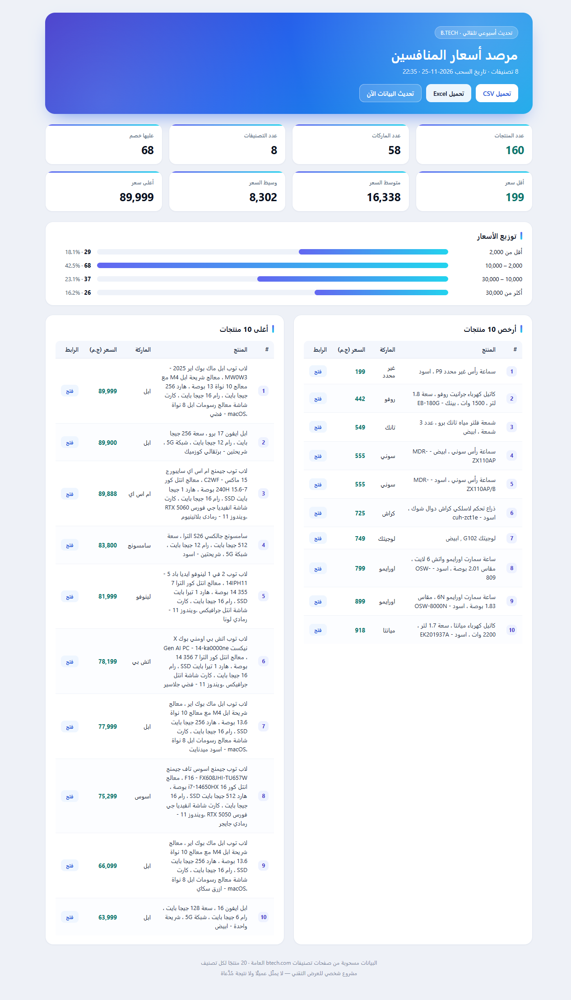

# مرصد أسعار المنافسين — B.TECH

> أداة تسحب بيانات المنتجات والأسعار من تصنيفات B.TECH، تنظّفها، وتُخرج ملف بيانات
> منظّمًا وتقريرًا من صفحة واحدة — مع تحديث أسبوعي تلقائي.

**العرض المباشر:** https://crop-risk--btech-price-radar-web.us-east.modal.run

| قبل — صفحة التصنيف في B.TECH | بعد — التقرير المُولَّد |
|---|---|
|  |  |

---

## What this is

A web-scraping pipeline that collects product prices from B.TECH (Egypt) category
pages, normalizes them into a single table, and publishes a one-page Arabic report
plus CSV/Excel downloads. It runs weekly on Modal with no server to maintain.

**Status:** personal training project — not a client engagement. No results or
clients are claimed beyond what the code produces.

---

## ما تفعله الأداة

```
طلب HTTP لصفحة تصنيف  →  استخراج JSON المضمّن في HTML  →  توحيد وإزالة تكرار
                      →  CSV + Excel  →  تقرير HTML من صفحة واحدة
```

| المرحلة | الملف | ما تفعله |
|---|---|---|
| الجلب | `src/fetch.py` | طلب واحد لكل تصنيف، كاش على القرص، 3 محاولات، تأخير 3 ثوان |
| الاستخراج | `src/parse.py` | قراءة JSON المهرَّب داخل الصفحة إلى حقول |
| التنظيف | `src/normalize.py` | إزالة التكرار، نسبة الخصم، بناء رابط المنتج |
| التصدير | `src/export.py` | CSV بترميز `utf-8-sig` + Excel منسّق |
| التقرير | `src/report.py` | صفحة RTL: مؤشرات + توزيع أسعار + أرخص/أغلى 10 |
| التشغيل | `src/run.py` | أمر واحد يشغّل السلسلة كاملة |
| النشر | `modal_app.py` | تحديث أسبوعي + صفحة عامة وتحميل الملفات |

---

## المصدر والالتزام

- **المصدر:** `https://btech.com` — تصنيفات عامة فقط.
- **`robots.txt`:** يسمح `/ar/c/*` · يمنع `/ar/s` (البحث) و`/ar/account` و`/ar/checkout`.
  الكود لا يستخدم أيًا من المسارات الممنوعة.
- **بلا تسجيل دخول** ولا كوكيز ولا حساب.
- **تأخير 3 ثوان** بين كل طلبين، و3 محاولات كحد أقصى.
- **النطاق:** 8 تصنيفات × 20 منتجًا = 160 صفًا في التشغيل.

### مصادر فُحصت ورُفضت (بأدلة)

| المصدر | نتيجة الفحص | سبب الرفض |
|---|---|---|
| `jumia.com.eg` | HTTP **403** | محجوب أمام الطلبات الآلية |
| `noon.com` | لا استجابة | محجوب |
| `mobileshop.com.eg` | Angular SPA | لا سعر في HTML الخام |
| `carrefouregypt.com` | 53 بايت لأي مسار (`AkamaiGHost`) | لا يمكن حتى قراءة `robots.txt` |

---

## التشغيل محليًا

```bash
pip install -r requirements.txt
python -m src.run
```

المخرجات في `output/YYYY-MM-DD/`:

```
products.csv    products.xlsx    report.html
```

تحديد تصنيفات معينة:

```bash
python -m src.run --categories mobile-phones,wearables
```

---

## النشر على Modal

```bash
modal run modal_app.py      # أول تشغيل: يسحب البيانات ويحفظها في Volume
modal deploy modal_app.py   # نشر الصفحة العامة
```

| المسار | المحتوى |
|---|---|
| `/` | التقرير مع أزرار التحميل |
| `/data.csv` | ملف CSV |
| `/data.xlsx` | ملف Excel |
| `/api/meta` | عدد المنتجات وتاريخ آخر تحديث |
| `POST /refresh` | إعادة السحب فورًا |

**الجدولة:** `modal.Cron("0 7 * * 1")` = كل اثنين 09:00 بتوقيت القاهرة.

---

## الاختبارات

```bash
python -m pytest -q
```

20 اختبارًا تغطي: الاستخراج من صفحة حقيقية محفوظة · الكاش وإعادة المحاولة · إزالة
التكرار · بناء الروابط · ترميز CSV · صحة Excel · محتوى التقرير · تشغيل السلسلة مع
تصنيف فاشل.

---

## حدود معروفة (مقيسة، لا مُقدَّرة)

1. **20 منتجًا لكل تصنيف** — الترقيم `?page=N` **لا يعمل** على الموقع (اختُبرت 7 صيغ،
   كلها تعيد نفس الـ20). التغطية الأوسع تحتاج تصنيفات أكثر، لا صفحات أكثر.
2. **لا تقييمات ولا مراجعات** في بيانات المصدر — لا تُذكر في التقرير.
3. **كل المنتجات `is_best_seller: true`** في المصدر، والقيمة ثابتة فلا تُستخدم كمؤشر.
   الموقع يعرض المنتجات المتوفرة فقط، لذا `in_stock` دائمًا `true`.
4. **لا مقارنة مع منافس ثانٍ** — كارفور محجوب (انظر الجدول أعلاه).

---

## التقنيات

Python 3.11 · `requests` · `pandas` · `openpyxl` · `pytest` · `FastAPI` · `Modal`

---

## إخلاء مسؤولية

مشروع شخصي للتدريب والعرض. البيانات ملك أصحابها، وتُستخدم هنا بغرض العرض التقني فقط.
